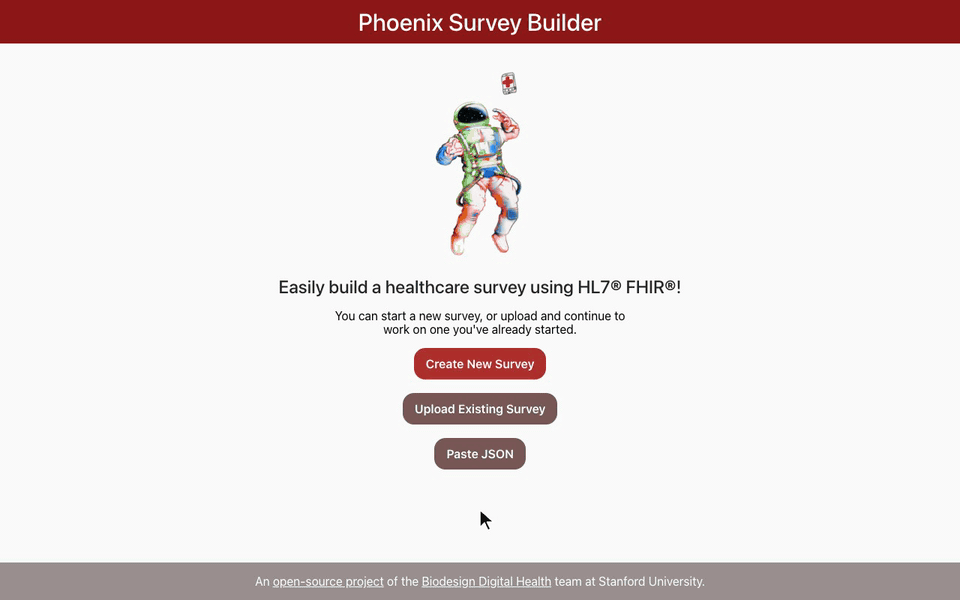

# Phoenix Survey Builder

[](https://github.com/StanfordBDHG/phoenix/actions/workflows/build-and-test.yml)

A web application that allows you to build healthcare surveys using the [HL7® FHIR® Questionnaire](https://www.hl7.org/fhir/questionnaire.html) international data standard using an interactive, drag-and-drop interface, and export JSON to be used in [Stanford Spezi](https://github.com/StanfordSpezi) iOS and Android applications to deliver surveys to patients.



## Features
- Drag and drop survey creation
- Exports surveys as HL7® FHIR® Questionnaires
- Upload and continue editing existing surveys
- Set skip logic and validation rules

## Requirements
- Node.js (version 24 or greater) & npm

## Getting Started
- To use the application online, visit [https://stanfordbdhg.github.io/phoenix](https://stanfordbdhg.github.io/phoenix).

## Open a Survey from a Link
Phoenix can open a FHIR Questionnaire straight from a link, so that tools such as AI coding agents can hand a survey to a person for review and editing:

- `https://stanfordbdhg.github.io/phoenix/#questionnaire=<JSON>` opens the survey in the link itself. `<JSON>` is the Questionnaire's UTF-8 JSON, [base64url](https://datatracker.ietf.org/doc/html/rfc4648#section-5)-encoded without padding. For longer surveys, use `#questionnaire-deflate=<data>`, where `<data>` is the JSON compressed with raw DEFLATE and then base64url-encoded. The part after `#` is never sent to a server, so the survey stays in the reviewer's browser.
- `https://stanfordbdhg.github.io/phoenix/?url=<URL>` loads the survey from an `https://` URL, such as a raw GitHub file. The server must allow cross-origin requests.

If a survey is already in progress, Phoenix asks before replacing it. The survey is then removed from the address bar, so reloading the page doesn't import it again.

To create a link from the command line:

```bash
# Short surveys
echo "https://stanfordbdhg.github.io/phoenix/#questionnaire=$(base64 < survey.json | tr '+/' '-_' | tr -d '=\n')"

# Any size (Node.js)
node -e 'const z=require("zlib"),j=require("fs").readFileSync(process.argv[1]);console.log("https://stanfordbdhg.github.io/phoenix/#questionnaire-deflate="+z.deflateRawSync(j).toString("base64url"))' survey.json
```

## Run for Development
First, ensure that Node.js (version 24 or greater) and npm are installed on your system.

In your terminal, clone this repository from GitHub to your local computer.

```bash
git clone https://github.com/StanfordBDHG/phoenix.git
```

Run the following command in the project directory to install dependencies.

```bash
npm install
```

Now, run the following command to start the application in development mode.

```bash
npm run dev
```

You should see the following message in your terminal if the application is running successfully.

```bash
  VITE v6.4.1  ready in 133 ms

  ➜  Local:   http://localhost:3000/
  ➜  Network: use --host to expose
  ➜  press h + enter to show help
```

You can now open [http://localhost:3000/phoenix](http://localhost:3000/phoenix) in your browser to view the application.

## Testing
Run the unit tests with Jest:

```bash
npm test
```

The end-to-end tests in `e2e/` use [Playwright](https://playwright.dev) to drive the app in a real browser, covering drag-and-drop in the survey tree and the reordering of answer options. They start their own development server. The first time, install Playwright's browser:

```bash
npx playwright install chromium
npm run test:e2e
```

To run them against your installed Google Chrome instead, use `PLAYWRIGHT_CHANNEL=chrome npm run test:e2e`.

### Updating the README demo
The animated demo at the top of this README (`figures/survey-builder-demo.gif`) is recorded by `scripts/record-readme-demo.mjs`. To re-record it after UI changes, start the development server with `npm run dev`, then run the following in a second terminal. This requires [ffmpeg](https://ffmpeg.org).

```bash
npm run record:demo
```

## Build for Production
First, ensure that Node.js (version 24 or greater) and npm are installed on your system.

In your terminal, clone this repository from GitHub to your local computer.

```bash
git clone https://github.com/StanfordBDHG/phoenix.git
```

Run the following command in the project directory to install dependencies.

```bash
npm install
```

Now, run the following command to build the application for production.

```bash
npm run build
```

The build files will be found in the `build/` subdirectory. You may deploy these files to the static web hosting service of your choice.

## Build and Run in Docker

First, build the Docker image:

```bash
docker build -t phoenix-survey-builder .
```

Then, run the Docker image:

```bash
docker run -p 8080:80 phoenix-survey-builder
```

> [!TIP]
> You may also substitute `8080` in the command above with a different port of your choice.

Open `http://localhost:8080/phoenix` in your browser to view the application.

## Deploy to GitHub Pages

The repository contains a GitHub Action that will deploy the application to GitHub pages: [deploy.yml](https://github.com/StanfordBDHG/phoenix/blob/dockerize/.github/workflows/deploy.yml). 

Before using the action:
1. Update `package.json` with the full GitHub pages URL for your repository in the `homepage` key, i.e. `https://username.github.io/repository`.
2. Update the main route path in `src/router/index.tsx` with your repository name:

```typescript
<Route path="/YOUR_REPOSITORY_NAME" element={
// remainder of code is unchanged
```

## Contributors & License

The Phoenix Survey Builder is licensed under the [MIT license](LICENSE). For a full list of contributors, see [CONTRIBUTORS.md](CONTRIBUTORS.md).

Phoenix was originally forked from the [Structor](https://github.com/helsenorge/structor) project in August 2022. We are grateful to the [Helse Norge](https://github.com/helsenorge) team for open-sourcing their work.

## Disclaimer
HL7®, and FHIR® are the registered trademarks of Health Level Seven International and their use of these trademarks does not constitute an endorsement by HL7.

This software is not intended to be a medical device.


